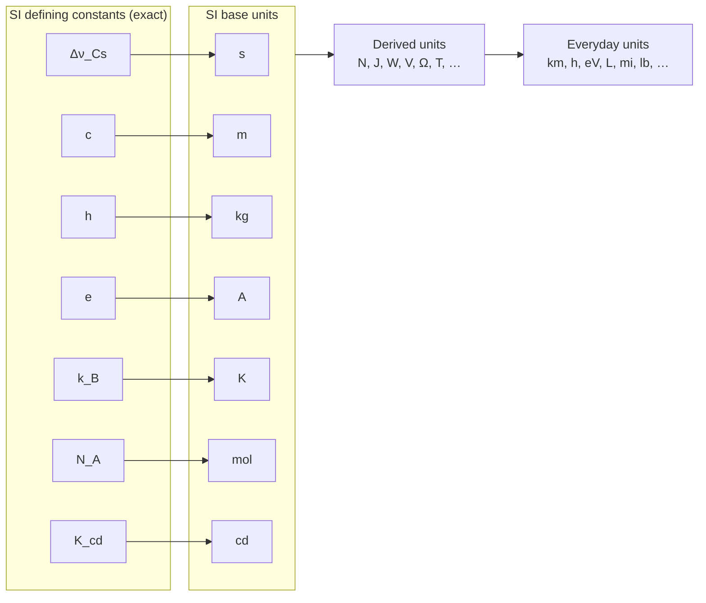

<div align="center">

# units-t

**Exact unit conversion and dimensional analysis for Python, built all the way down to the fundamental constants.**

[](https://github.com/andrewsharmon/units-t/actions/workflows/ci.yml)


</div>

```python
>>> from units_t import units as u
>>> print((26.2 * u.mi).to(u.km))
42.1648128 km
```

`units-t` attaches units to numbers, converts between them exactly, and refuses to let
you add metres to seconds. Every unit in the library has an exact definition that goes
back through the SI base units to the seven constants that have defined the SI since 2019.

## Why units-t?

- **Exact by construction.** Conversion factors are rational numbers (`Fraction`), not
  floats. A mile is *exactly* `25146/15625` km, and an electronvolt is *exactly*
  `1.602176634e-19` J.
- **Grounded in physics.** The second, metre, kilogram, ampere, kelvin, mole and candela
  are each tied to a defining constant (Δν_Cs, c, h, e, k_B, N_A, K_cd). Everything else
  is built from those.
- **Dimensional safety.** Every quantity carries its physical dimension, so mistakes like
  `metres + seconds` raise an error instead of returning a wrong number.
- **Zero dependencies.** Pure Python, fully type-annotated (`py.typed`), checked with
  `mypy --strict`.

## Installation

`units-t` is not on PyPI yet. Install it straight from GitHub:

```bash
pip install git+https://github.com/andrewsharmon/units-t.git
```

or, in a uv project:

```bash
uv add git+https://github.com/andrewsharmon/units-t.git
```

Requires Python 3.11 or newer.

## Quick start

```python
from units_t import units as u
from units_t import constants as const

# Attach a unit by multiplying
speed = 100 * u.km / u.h

# Convert with .to()
print(speed.to(u.m / u.s))        # 27.77777777777778 m/s
print(speed.to(u.m / u.s).value)  # 250/9  (exact Fraction under the hood)

# Physics, straight from the constants: energy of a 500 nm photon
photon = const.h * const.c / (500 * u.nm)
print(photon.to(u.eV))            # 2.479683968664005 eV
```

## Usage guide

### Quantities and conversion

Multiplying a number by a unit gives you a `Quantity`. Use `.to()` to convert it to
any unit with the same dimension.

```python
energy = (2 * u.kW) * (3 * u.h)
print(energy)                              # 6 kW·h
print(energy.to(u.prefixed("mega", u.J)))  # 21.6 MJ

area = (3 * u.ft) ** 2
print(area.to(u.m**2))                     # 0.83612736 m^2
```

Integer and `Fraction` values stay exact through conversion. Floats are converted with
a single multiplication by the exact factor. `str()` shows exact values as decimals,
and `.value` holds the exact value.

### Arithmetic

Quantities support `+`, `-`, `*`, `/`, `**`, negation, `abs()`, comparisons and
hashing. When you add or subtract, the result uses the left operand's unit:

```python
print(1 * u.km + 250 * u.m)       # 1.25 km
print(1 * u.km == 1000 * u.m)     # True
print(1 * u.mi > 1 * u.km)        # True

force = (75 * u.kg) * (9.81 * u.m / u.s**2)
print(force.to(u.N))              # 735.75 N
```

### Dimensional analysis

Every unit and quantity has a `Dimension`. A dimension is a vector of exponents over
the seven SI base dimensions: length **L**, mass **M**, time **T**, current **I**,
temperature **Θ**, amount **N** and luminous intensity **J**.

```python
print(u.V.dimension)                           # L^2·M·T^-3·I^-1
print(force.dimension)                         # L·M·T^-2
print(u.N.is_compatible(u.kg * u.m / u.s**2))  # True
print(u.J == u.N * u.m)                        # True
```

Combining incompatible dimensions raises `DimensionError`:

```python
from units_t import DimensionError

(1 * u.m).to(u.s)
# DimensionError: cannot convert m [L] to s [T]
```

Fractional exponents are supported, for example in noise spectral density:

```python
from fractions import Fraction

noise = u.V / u.Hz ** Fraction(1, 2)
print(noise.dimension)            # L^2·M·T^(-5/2)·I^-1
```

### Fundamental constants

`units_t.constants` holds the seven exact SI defining constants as quantities, plus
constants that follow exactly from them:

| Name          | Constant                    | Value (exact)                  |
| ------------- | --------------------------- | ------------------------------ |
| `delta_nu_Cs` | Caesium hyperfine frequency | 9 192 631 770 Hz               |
| `c`           | Speed of light in vacuum    | 299 792 458 m/s                |
| `h`           | Planck constant             | 6.626 070 15 × 10⁻³⁴ J·s       |
| `e`           | Elementary charge           | 1.602 176 634 × 10⁻¹⁹ C        |
| `k_B`         | Boltzmann constant          | 1.380 649 × 10⁻²³ J/K          |
| `N_A`         | Avogadro constant           | 6.022 140 76 × 10²³ mol⁻¹      |
| `K_cd`        | Luminous efficacy (540 THz) | 683 lm/W                       |
| `R`           | Molar gas constant, N_A·k_B | 8.314 462 618 153 24 J/(mol·K) |
| `F`           | Faraday constant, N_A·e     | 96 485.332 123 310 0184 C/mol  |

```python
light_time = (1 * u.au) / const.c
print(light_time.to(u.minute))    # 8.316746397269274 min
```

### Defining your own units

Create a new unit from an existing one with an exact factor (an `int`, `Fraction` or
decimal string). Floats are not accepted, so definitions stay exact.

```python
furlong = u.yd.scaled(220, "fur")
fortnight = u.day.scaled(14, "fortnight")

print((1 * u.m / u.s).to(furlong / fortnight))  # 6012.884753042234 fur/fortnight

MW = u.prefixed("mega", u.W)      # any of the 24 SI prefixes, quecto to quetta
print((5 * MW).to(u.kW))          # 5000.0 kW
```

## How it works: down to the constants



A `Unit` is three things: a symbol, a **dimension**, and an exact **scale**, the
`Fraction` that converts one of this unit into the coherent SI unit of the same
dimension. To convert, the library divides one scale by the other and checks that the
dimensions match. Because each scale comes from exact definitions (the 1959 inch, the
fixed value of *e* for the electronvolt, the IAU astronomical unit), the result is exact
too.

## What's included

| Category                   | Units                                                                                              |
| -------------------------- | -------------------------------------------------------------------------------------------------- |
| SI base                    | `s` `m` `kg` `A` `K` `mol` `cd`                                                                    |
| SI derived (special names) | `Hz` `N` `Pa` `J` `W` `C` `V` `F` `ohm` `S` `Wb` `T` `H` `lm` `lx` `Bq` `Gy` `Sv` `kat`            |
| Dimensionless              | `one` `rad` `sr`                                                                                   |
| Prefixed shortcuts         | `km` `cm` `mm` `um` `nm` `g` `mg` `ms` `us` `ns` `kHz` `MHz` `GHz` `kJ` `kW` `kPa` `mA` `mV` `kV` |
| Accepted non-SI            | `minute` `h` `day` `L` `mL` `tonne` `au` `eV` `keV` `MeV` `GeV`                                    |
| Imperial / US customary    | `inch` `ft` `yd` `mi` `lb` `oz`                                                                    |

Any unit can take an SI prefix with `u.prefixed(name, unit)`.

## Project layout

```
src/units_t/
├── dimensions.py   # Dimension: exponent vectors over the 7 SI base dimensions
├── unit.py         # Unit: symbol + exact scale + dimension
├── quantity.py     # Quantity: value + unit, with arithmetic and comparison
├── units.py        # catalogue of SI, prefixed, non-SI and imperial units
├── constants.py    # fundamental constants as Quantities
├── _defining.py    # exact numerical values of the SI defining constants
└── exceptions.py   # UnitsError, DimensionError
```

## Roadmap

- [ ] Measured CODATA constants (G, mₑ, α, …) with uncertainties
- [ ] Affine units (°C, °F) and logarithmic units (dB, Np)
- [ ] Natural, Planck, atomic and Gaussian unit systems derived from the constants
- [ ] Buckingham π-theorem tools for dimensional analysis
- [ ] Uncertainty propagation through conversions
- [ ] Parsing unit expressions (`"kg*m/s^2"`)
- [ ] NumPy array support

## Development

The project uses [uv](https://docs.astral.sh/uv/).

```bash
git clone https://github.com/andrewsharmon/units-t.git
cd units-t
uv sync                      # create .venv and install dev dependencies
uv run pytest                # run the test suite
uv run ruff check .          # lint
uv run ruff format .         # format
uv run mypy                  # type-check (strict)
uv run pre-commit install    # run the checks on every commit
```

CI runs lint, format and type checks, and runs the tests on Python 3.11, 3.12 and 3.13.

## License

MIT. See [LICENSE](LICENSE).
